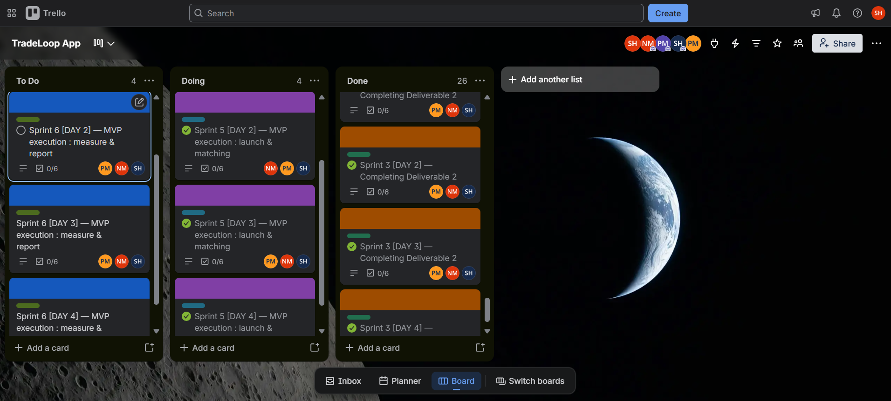
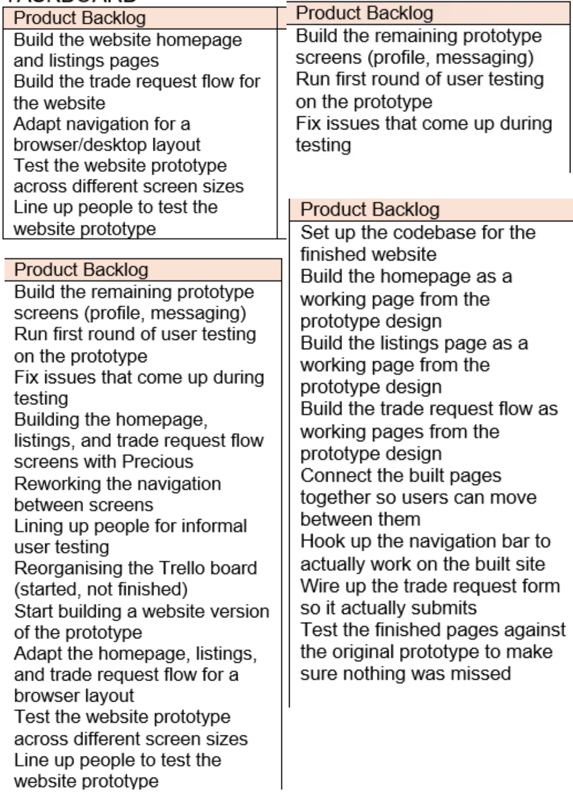

# Digital Portfolio: 

**Name:** Stephen Hendricks
**Student number:** 222774703
**Qualification:** Diploma in Information and Communication Technology, CPUT
**Project:** TradeLoop

## About this portfolio

This portfolio collects the evidence from my Agile project work on TradeLoop, a hyperlocal platform that connects skilled informal workers in Khayelitsha with households that need small tasks done. Each section below contains the evidence I produced with my team and a reflection on what I learned from it.

## Contents

1. [Agile Team Charter](#agile-team-charter)
2. [User Stories and Tasks](#user-stories-and-tasks)
3. [Product Backlog](#product-backlog)
4. [Sprint Backlog](#sprint-backlog)
5. [Agile Logbook](#agile-logbook)
6. [Overall Reflection](#overall-reflection)

---

## Agile Team Charter

### Evidence

The Agile Team Charter is the agreement our team made about our purpose, roles, values, communication plan, goals and milestones. I worked on it as the team's Designer.

- [Download or view the Agile Team Charter (PDF)](team-charter.pdf)

### Reflection

**What I did:** In our team of three, I was the Designer, which in our charter meant looking after branding, visual layout and the look of our documents. Together with Precious and Ntombenhle, I agreed on our purpose, our vision for TradeLoop in Khayelitsha, our roles, our values, how we would communicate, and our SMART goals and milestones. All three of us signed off on the charter once it was agreed.

**What I learned:** I learned that a charter is useful because it settles things before they turn into arguments. Writing down our values (collaboration, respect, transparency, accountability and continuous improvement) and our communication plan, with WhatsApp check-ins twice a week and a review meeting before each submission, gave us something to go back to when work got busy. I also learned that agreeing on roles does not mean working alone, because our charter makes research a shared responsibility for all of us.

**What I will do next:** In future projects I will agree on roles, meetings and goals in the first week and write them down. I will also update the charter when the plan changes instead of leaving it as a one-off document.

---

## User Stories and Tasks

### Evidence

User stories describe a feature from the end user's point of view. We broke each story into smaller tasks and managed them on a Trello board.

- [User Stories and Tasks (PDF)](user-stories.pdf)
- [Our Trello board](https://trello.com/invite/b/69f7cbd7f59c561feaa2764e/ATTI827328e7623ba3384ef2b8eca4b42c860ACA38D2/tradeloop-app)

### Reflection

**What I did:** Our user stories were written on Trello cards in the form "As a..., I want..., so that...". They covered different people: a resident of Khayelitsha who needs a trusted worker quickly (Sprint 1), our two marketplace user groups and our USP (Sprint 3), a first-time visitor to our website, a new user signing up, a client paying for a job, a developer, and our own team. I was assigned to the Sprint 1 and Sprint 3 cards together with Precious and Ntombenhle.

**What I learned:** I learned that a good user story explains why a feature matters to a real person, not only what to build. Writing about Nomsa and her broken geyser made the problem concrete and helped us test whether people would really act on it, not just agree with it on a survey. I also learned that not every story is about a customer. Some were for the team (like the prototype we could demo) or for a developer (like the real database), and they still needed a clear reason. Splitting each story into tasks made big pieces of work, like the escrow payment flow, easier to manage.

**What I will do next:** Next time I will write smaller stories so that each one can be finished and tested on its own, and I will check each story with a teammate before we start building it.

---

## Product Backlog

### Evidence

The product backlog is the prioritised list of all the work, features and improvements TradeLoop needs.

- [Product Backlog (PDF)](product-backlog.pdf)

### Reflection

**What I did:** I worked with my team on the product backlog and followed it on our Trello taskboard, where items start in the Product Backlog column and then move to In Progress and Completed. Our backlog started with finishing the prototype screens and testing them, then moved to a website version, and finally to building the real pages from the prototype design.

**What I learned:** I learned that a backlog changes as you learn. After building and testing the prototype, our list moved from prototype screens to a browser version and then to real working pages. I also saw that some items, like lining up people to test, appeared on the list more than once, which showed they were not finished. The backlog also needs tidying, because reorganising our Trello board was started but not finished.

**What I will do next:** In future I will review and clean the backlog at the start of every sprint, remove items that are done or repeated, and put the most important items first so that the team always knows what to do next.

---

## Sprint Backlog

### Evidence

The sprint backlog is the set of work we selected from the product backlog to reach our sprint goal.

- [Sprint Backlog (PDF)](sprint-backlog.pdf)

### Reflection

**What I did:** Our sprint cards each had a clear goal. Sprint 7 ran over four days: a marketing website, an interactive app prototype, a real backend and database, and real phone-based authentication. Sprint 8 started with a real payment and escrow integration. Each card was marked complete once its goal was reached.

**What I learned:** Planning a sprint taught me to choose a goal that is small enough to finish. Each day had one clear outcome, like replacing demo data with a real database, and each day built on the one before. The prototype ran on demo data first, and then the backend and sign-up were replaced with real ones. I learned that this order lets a team show something working early and then make it real. I also saw that goals like payments and escrow need careful planning, because they involve real money and trust.

**What I will do next:** In my next sprint I will keep the goal to one thing per day, list the tasks under it beforehand, and check at the end of each day whether the goal was really met before moving on.

---

## Agile Logbook

### Evidence

The logbook records our stand-ups, sprint plans and retrospective notes.

- [Agile Logbook (PDF)](agile-logbook.pdf)

### Reflection

**What I did:** Each logbook entry answered three questions: what we did since the last stand-up, what we planned to do next, and what was blocking us. In the first week we were building the remaining prototype screens with Precious, reworking the navigation, and running our first user tests with two people. In the second week we started turning the prototype into a website and adapting it for a browser layout. In the third week we set up the codebase and built the working homepage, listings page and trade request flow, then tested them against the original prototype.

**What I learned:** The logbook showed me problems I would have forgotten otherwise. For example, Precious and I did not fully agree on where the back button should take you on one screen, and the navigation stayed unsettled for a few days. The feedback from our two testers was mixed, which taught us that two testers are not enough to be sure which changes matter. Moving from the phone prototype to a browser version also showed me that a layout designed for mobile does not simply stretch to a desktop screen. Writing down our blockers every day made them harder to ignore.

**What I will do next:** In future projects I will keep a short daily log, because the blockers and decisions in it make the retrospective much easier. I will also test with more people before deciding on big changes.

---

## Overall Reflection

Looking back, the five parts of this portfolio belong together. The charter set out how Precious, Ntombenhle and I would work and what we agreed on. The user stories described what TradeLoop needed to do for real people, starting with someone in Khayelitsha who needs a trusted worker quickly. The product backlog turned those stories into a list of work, the sprint backlog chose what to do first, and the logbook recorded what actually happened day by day, including our disagreements and problems.

Doing all of this showed me that Agile is about learning and adjusting. Our plan changed after user testing, after we moved from a prototype to a website, and as we replaced demo features with real ones. At the start I saw these documents as paperwork, but by the end I was using them to make decisions and to spot problems early. In future projects I will keep them up to date as a habit, not only for submission.
